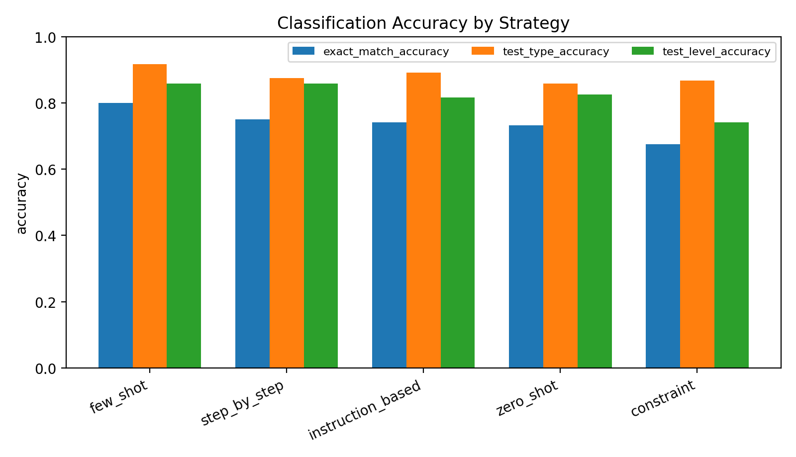
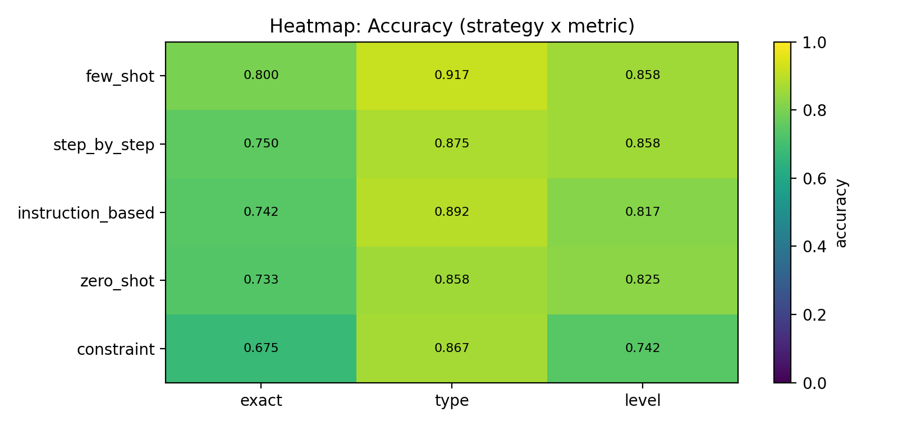

# LLM Classification - Manual vs LLM (By Strategy)

This report compares manual labels against LLM-predicted labels for:

- Manual labels: `data/scenario_manual_labels.csv`
- LLM outputs: `outputs/llm_classification` (`llm_*.json`)

## How to read

- `test_level accuracy`: match rate for the `test_level` label.
- `test_type accuracy`: match rate for the `test_type` label.
- `exact (both)`: both labels match simultaneously (stricter).
- `Unknown`: the LLM output can use `Unknown` as a label; see `tables/strategies_summary.csv` for rates.
- Accuracy is computed only over scenario IDs present in both sources (manual AND LLM).

## Inputs / label taxonomy

- Manual label source-of-truth: `data/scenario_manual_labels.csv`
- Prompt templates defining label meanings: `prompts/llm_classification/*.txt`
- Allowed labels (used by generation script): `scripts/classify_scenarios.py` (`TEST_LEVELS`, `TEST_TYPES`)
- Class balance: `tables/manual_label_distribution.csv` (imbalanced labels can inflate/deflate accuracy).

## Accuracy summary

- `constraint`: level=74.2%, type=86.7%, exact=67.5%
- `few_shot`: level=85.8%, type=91.7%, exact=80.0%
- `instruction_based`: level=81.7%, type=89.2%, exact=74.2%
- `step_by_step`: level=85.8%, type=87.5%, exact=75.0%
- `zero_shot`: level=82.5%, type=85.8%, exact=73.3%

## Summary table

| strategy | n | exact (both) | test_type | test_level | unknown_any_rate | missing_in_llm | missing_in_manual |
| --- | ---: | ---: | ---: | ---: | ---: | ---: | ---: |
| `few_shot` | 120 | 80.0% | 91.7% | 85.8% | 0.0% | 0 | 0 |
| `step_by_step` | 120 | 75.0% | 87.5% | 85.8% | 0.0% | 0 | 0 |
| `instruction_based` | 120 | 74.2% | 89.2% | 81.7% | 0.0% | 0 | 0 |
| `zero_shot` | 120 | 73.3% | 85.8% | 82.5% | 0.0% | 0 | 0 |
| `constraint` | 120 | 67.5% | 86.7% | 74.2% | 0.0% | 0 | 0 |

- Full metrics: `tables/strategies_summary.csv`

## Best Strategy (Ranked)

- Ranking: exact_match > test_type > test_level
- Best: `few_shot` (exact=80.0%, type=91.7%, level=85.8%)

## Quick takeaways

- Best overall: `few_shot` (exact=80.0%).
- Worst overall: `constraint` (exact=67.5%).
- Unknown label usage: min=0.0%, max=0.0%.
- Recommended default: use the best overall strategy unless you have a known label-specific weakness.

## Top confusions (best strategy)

### test_level

- Total mismatches: 17

| manual | llm | count | % of mismatches |
| --- | --- | ---: | ---: |
| `System` | `Integration` | 11 | 64.7% |
| `Acceptance` | `System` | 5 | 29.4% |
| `System` | `Acceptance` | 1 | 5.9% |

### test_type

- Total mismatches: 10

| manual | llm | count | % of mismatches |
| --- | --- | ---: | ---: |
| `Security` | `Error Handling` | 4 | 40.0% |
| `Regression` | `Functional` | 3 | 30.0% |
| `Functional` | `Error Handling` | 1 | 10.0% |
| `Error Handling` | `Regression` | 1 | 10.0% |
| `End-to-End` | `Functional` | 1 | 10.0% |

## Figures

## Drill-down (per strategy)

Per-strategy details are in `by_strategy/<strategy>/`:

- `classification_summary.md`: quick per-strategy overview
- `tables/level_confusion_matrix.csv` / `tables/type_confusion_matrix.csv`: label confusions
- `tables/classification_comparison.csv`: row-level audit (largest file)

## Data distribution (manual labels)

- `tables/manual_label_distribution.csv` (class balance for `test_level` / `test_type`)

## Reproduce

- `python scripts/analyze_classification.py --llm-json outputs/llm_classification`
