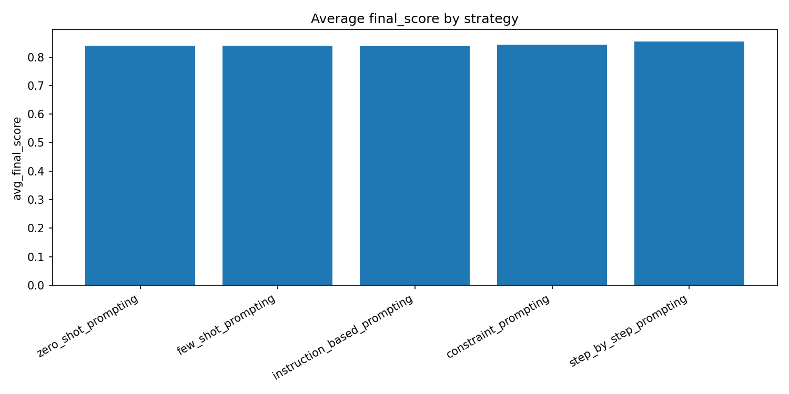
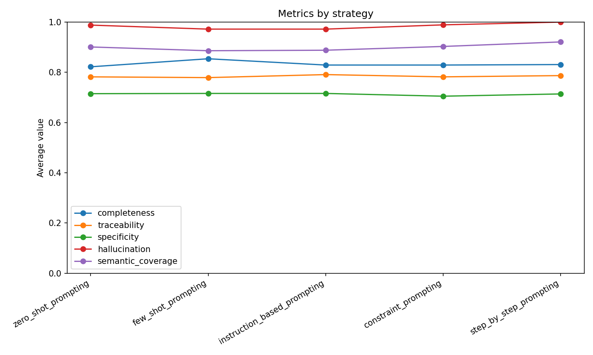
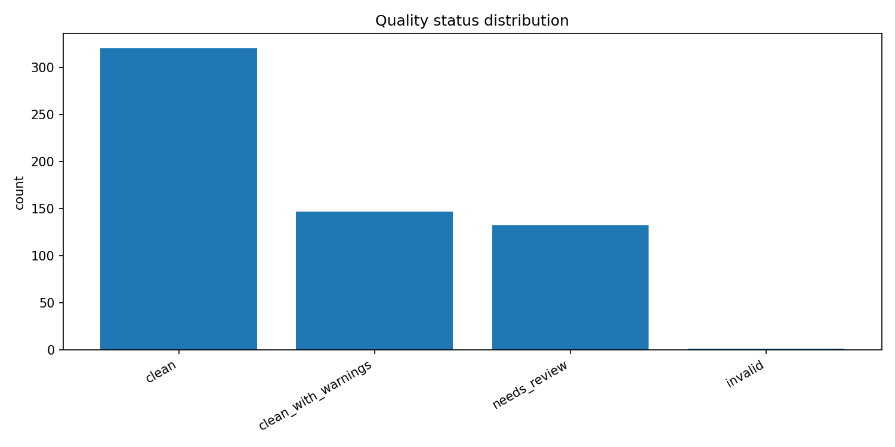
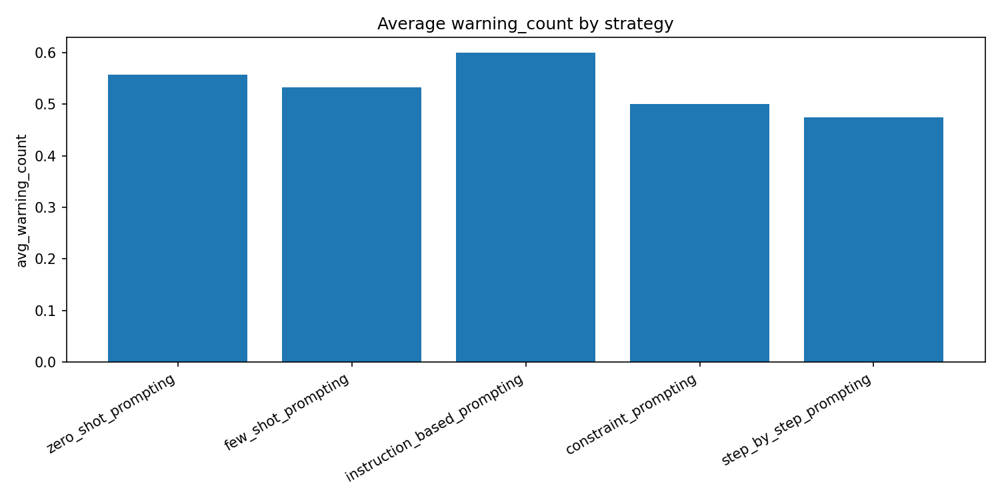
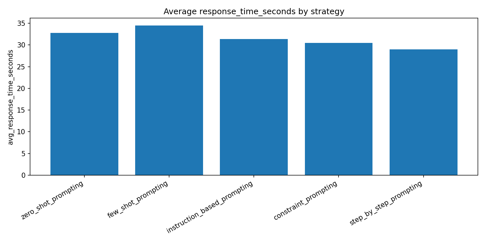
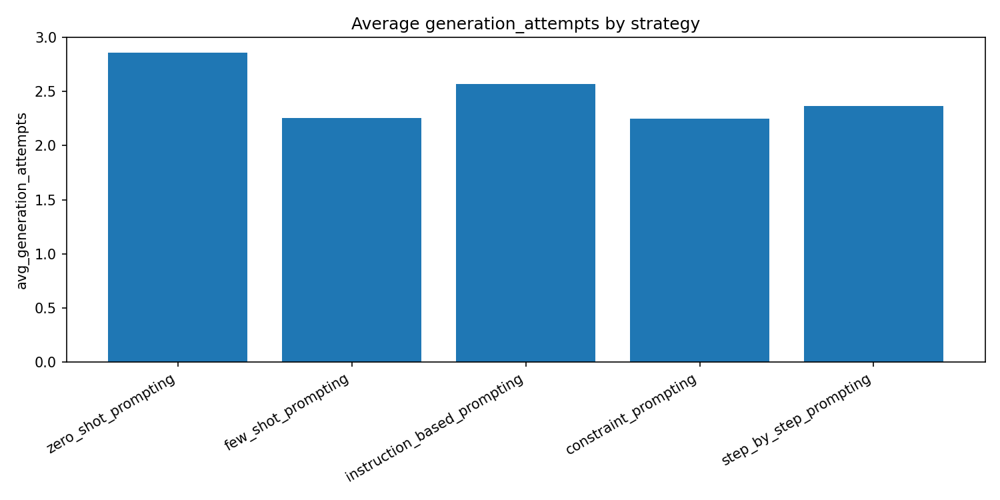
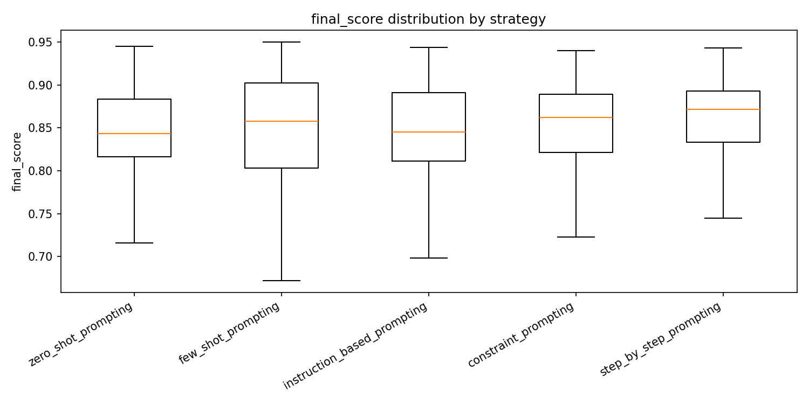
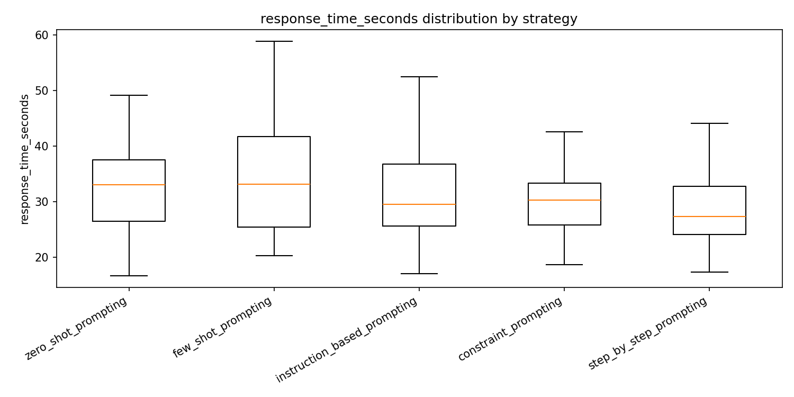

# Test Generation Experiment - Analysis

## Setup

- Counts are derived from `analysis/llm_test_generation/tables/results_detailed.csv` (unique `scenario_id` and total rows).
- Scenarios analyzed: **120**
- Generated test cases: **600**
- Model(s): **llama3.2:3b**
- Strategies compared: **5**

## Scoring

- `stability = 1 / (1 + (0.25*low + 0.50*medium + 1.00*high))`
- `speed = fastest_time / time` (per scenario), clamped to `[0, 1]`
- `final_score = 0.20*completeness + 0.20*traceability + 0.15*specificity + 0.20*semantic_coverage + 0.15*hallucination + 0.05*stability + 0.05*speed`

### Metric definitions (what the scores mean)

- `completeness`: penalizes missing required parts (e.g., too few expected results, missing key literals, missing preconditions/When/Then coverage).
- `traceability`: measures whether key scenario literals are preserved in steps/expected results and whether expected results are linked to steps.
- `specificity`: rewards concrete, executable steps and concrete assertions (vs vague/generic text).
- `hallucination`: penalizes invented details not grounded in the scenario.
- `semantic_coverage`: composite semantic quality (executable steps, precondition mapping, literal preservation, step/result separation) with hard penalties for critical issues.
- `stability`: based only on warning severities (low/medium/high), independent of content length.
- `speed`: normalized per-scenario relative to the fastest strategy for that scenario; compare within the same run/hardware.

### Quality status / rates

- `valid_rate`: fraction of generated test cases with no critical errors (e.g., missing steps/expected results).
- `clean_rate`: fraction with `quality_status == clean` (no warnings).
- `needs_review_rate`: fraction with `quality_status == needs_review` (at least one high-severity warning).
- `clean_with_warnings_rate`: tracked in CSV; warnings exist but none are high severity.

## Executive summary

- Best overall quality (avg final_score): `step_by_step_prompting` (avg_final_score=0.854)
- Cleanest outputs (clean_rate): `constraint_prompting` (clean_rate=0.575)
- Fastest typical (median response time): `step_by_step_prompting` (median_response_time_seconds=27.319)
- Fastest tail (p95 response time): `constraint_prompting` (p95_response_time_seconds=40.302)
- Most consistent scores (std final_score): `step_by_step_prompting` (std_final_score=0.058)
- Fewest warnings (avg warning_count): `step_by_step_prompting` (avg_warning_count=0.475)

## Ranking (avg `final_score`)

| Rank | Strategy | Avg Final Score | Main Strength |
| ---: | --- | ---: | --- |
| 1 | step_by_step_prompting | 0.854 | Final score |
| 2 | constraint_prompting | 0.843 | Clean rate |
| 3 | zero_shot_prompting | 0.839 | Balanced |
| 4 | few_shot_prompting | 0.839 | Balanced |
| 5 | instruction_based_prompting | 0.838 | Balanced |

## Strategy Comparison (key metrics)

| strategy | valid_rate | clean_rate | needs_review_rate | avg_final_score | avg_final_score_ci_low | avg_final_score_ci_high | median_final_score | avg_response_time_seconds | median_response_time_seconds | p95_response_time_seconds | avg_generation_attempts | avg_warning_count |
| --- | ---: | ---: | ---: | ---: | ---: | ---: | ---: | ---: | ---: | ---: | ---: | ---: |
| step_by_step_prompting | 1.000 | 0.567 | 0.183 | 0.854 | 0.843 | 0.864 | 0.871 | 28.953 | 27.319 | 41.252 | 2.367 | 0.475 |
| constraint_prompting | 1.000 | 0.575 | 0.208 | 0.843 | 0.830 | 0.855 | 0.862 | 30.471 | 30.289 | 40.302 | 2.250 | 0.500 |
| zero_shot_prompting | 1.000 | 0.508 | 0.225 | 0.839 | 0.828 | 0.850 | 0.843 | 32.798 | 33.045 | 43.882 | 2.858 | 0.558 |
| few_shot_prompting | 0.992 | 0.533 | 0.200 | 0.839 | 0.823 | 0.854 | 0.857 | 34.476 | 33.164 | 50.092 | 2.258 | 0.533 |
| instruction_based_prompting | 1.000 | 0.483 | 0.283 | 0.838 | 0.826 | 0.849 | 0.845 | 31.404 | 29.518 | 45.278 | 2.567 | 0.600 |

## Warnings (top types)

| warning_type | severity | count | % of test cases | most_common_strategy |
| --- | --- | ---: | ---: | --- |
| generic_expected_result | low | 157 | 26.17% | zero_shot_prompting |
| missing_literal_value | high | 86 | 14.33% | instruction_based_prompting |
| irrelevant_or_invented_step | high | 40 | 6.67% | few_shot_prompting |
| redundant_expected_result | low | 10 | 1.67% | instruction_based_prompting |
| unsupported_precondition | high | 10 | 1.67% | zero_shot_prompting |
| missing_when_action_literal | high | 9 | 1.50% | instruction_based_prompting |
| redundant_step | low | 3 | 0.50% | few_shot_prompting |
| unsupported_action_step | high | 2 | 0.33% | few_shot_prompting |
| min_test_steps_not_met | low | 2 | 0.33% | zero_shot_prompting |
| assertion_in_step | medium | 1 | 0.17% | zero_shot_prompting |

### What to fix first

- `generic_expected_result`: force concrete assertions (exact literals, measurable outcomes).
- `missing_literal_value`: require literal values (IDs, exact strings, numbers) in steps/expected results.
- `irrelevant_or_invented_step`: tighten grounding: only allow steps traceable to the scenario.

## Takeaways

- Default choice: `step_by_step_prompting` (best avg `final_score`).
- Close alternative: `constraint_prompting` (similar overall performance).
- Best hallucination score: `step_by_step_prompting` (interpret together with warnings/clean rate).
- Averages can hide variance; prefer the distribution boxplots for robustness checks.

## Manual label breakdown

- `by_manual_labels/analysis.md`

## Hardest scenarios (across all strategies)

| scenario_id | scenario_name | avg_final_score | valid_rate | avg_warning_count |
| --- | --- | ---: | ---: | ---: |
| SCN-102 | Reject absolute paths in ticket id | 0.636 | 1.000 | 3.000 |
| SCN-009 | ID resolution works with dep command | 0.660 | 1.000 | 1.600 |
| SCN-116 | Resolve unknown id in isolation | 0.660 | 1.000 | 1.000 |
| SCN-005 | Ambiguous ID error | 0.681 | 1.000 | 1.000 |
| SCN-115 | Resolve ambiguous prefix in isolation | 0.703 | 1.000 | 1.000 |
| SCN-114 | Resolve suffix in isolation | 0.711 | 1.000 | 0.400 |
| SCN-113 | Resolve exact id in isolation | 0.729 | 1.000 | 0.200 |
| SCN-119 | Using TICKETS_DIR works in a normal flow | 0.729 | 1.000 | 2.800 |
| SCN-027 | Tickets directory created on demand | 0.743 | 1.000 | 1.000 |
| SCN-034 | View dependency tree | 0.755 | 1.000 | 0.800 |

- Full list: `tables/results_by_scenario.csv`

## Reproduce

- Generate analysis + figures: `python scripts/analyze_test_generation.py`
- Manual label breakdown: `python scripts/analyze_test_generation_by_class.py`

## Outputs

- `analysis/llm_test_generation/tables/results_detailed.csv`
- `analysis/llm_test_generation/tables/results_by_strategy.csv`
- `analysis/llm_test_generation/tables/results_by_scenario.csv`
- `analysis/llm_test_generation/tables/warnings_by_type.csv`
- `analysis/llm_test_generation/figures/`
