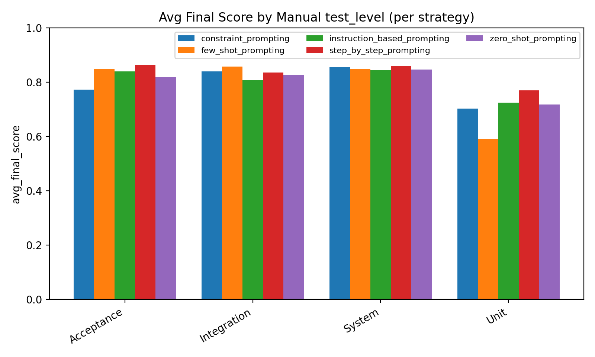
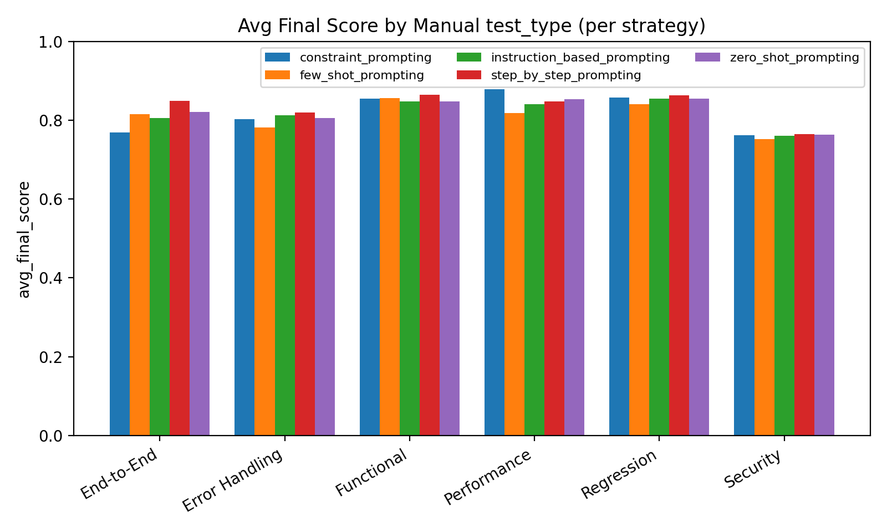
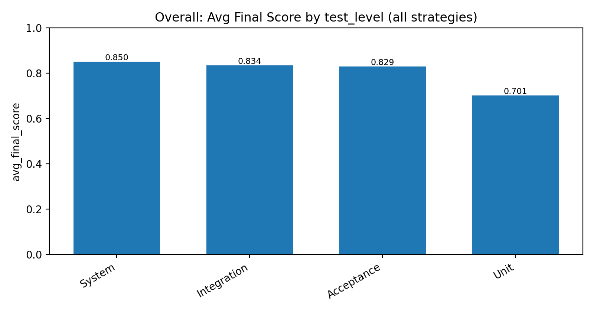
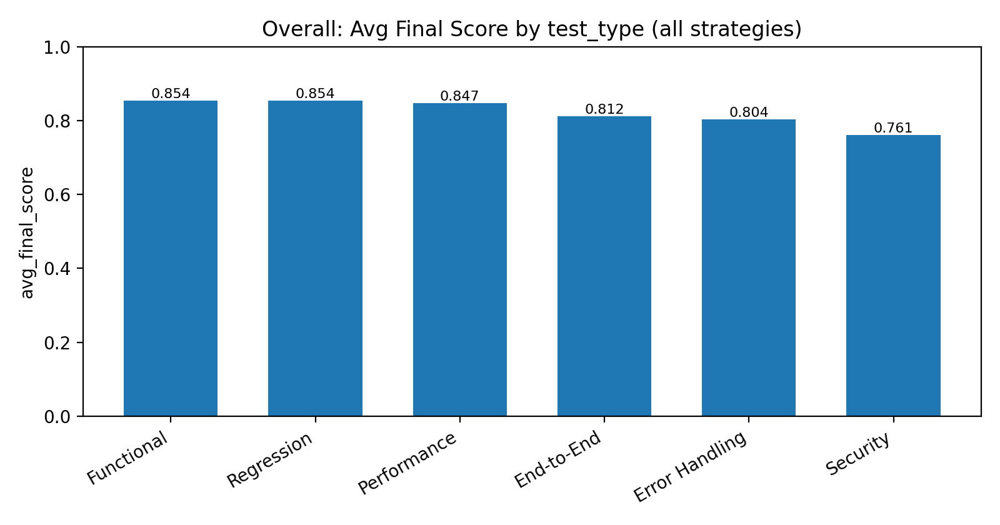
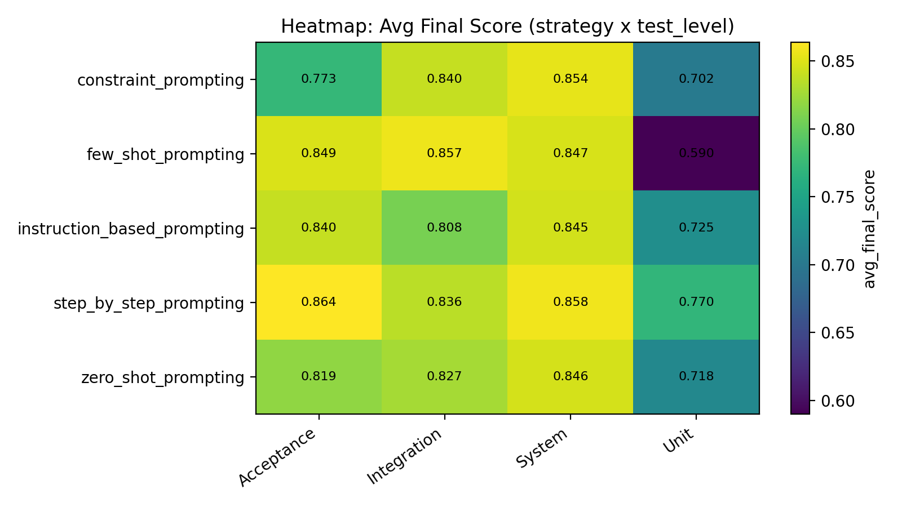

# Test Generation Quality - By Manual Labels

This report groups test generation results by manual labels (`test_level`, `test_type`) and links the relevant `.png` figures.
All scores are based on `final_score` from `analysis/llm_test_generation/tables/results_detailed.csv`.

## 1. Quick read (how to interpret)

- Treat categories with **very small `n`** (e.g., `n=1`) as illustrative, not definitive.
- For broad conclusions, use the **overall summaries** and the **heatmaps**.

## 2. Best strategy per category (avg `final_score`)

### By `test_type` (best strategy)

| test_type | best_strategy | avg_final_score | valid_rate | avg_warning_count | n |
| --- | --- | ---: | ---: | ---: | ---: |
| End-to-End | `step_by_step_prompting` | 0.849 | 100.0% | 1.00 | 3 |
| Error Handling | `step_by_step_prompting` | 0.819 | 100.0% | 1.00 | 17 |
| Functional | `step_by_step_prompting` | 0.865 | 100.0% | 0.30 | 89 |
| Performance | `constraint_prompting` | 0.879 | 100.0% | 0.25 | 4 |
| Regression | `step_by_step_prompting` | 0.863 | 100.0% | 0.33 | 3 |
| Security | `step_by_step_prompting` | 0.765 | 100.0% | 1.50 | 4 |

### By `test_level` (best strategy)

| test_level | best_strategy | avg_final_score | valid_rate | avg_warning_count | n |
| --- | --- | ---: | ---: | ---: | ---: |
| Acceptance | `step_by_step_prompting` | 0.864 | 100.0% | 0.43 | 7 |
| Integration | `few_shot_prompting` | 0.857 | 100.0% | 0.22 | 9 |
| System | `step_by_step_prompting` | 0.858 | 100.0% | 0.48 | 100 |
| Unit | `step_by_step_prompting` | 0.770 | 100.0% | 0.50 | 4 |

## 3. Overall performance by category (all strategies pooled)

### By `test_level` (overall)

- `System`: avg_final_score=0.850, valid_rate=100.0%, avg_warning_count=0.52, n=500
- `Integration`: avg_final_score=0.834, valid_rate=100.0%, avg_warning_count=0.47, n=45
- `Acceptance`: avg_final_score=0.829, valid_rate=97.1%, avg_warning_count=0.74, n=35
- `Unit`: avg_final_score=0.701, valid_rate=100.0%, avg_warning_count=0.65, n=20

### By `test_type` (overall)

- `Functional`: avg_final_score=0.854, valid_rate=99.8%, avg_warning_count=0.36, n=445
- `Regression`: avg_final_score=0.854, valid_rate=100.0%, avg_warning_count=0.33, n=15
- `Performance`: avg_final_score=0.847, valid_rate=100.0%, avg_warning_count=0.75, n=20
- `End-to-End`: avg_final_score=0.812, valid_rate=100.0%, avg_warning_count=1.40, n=15
- `Error Handling`: avg_final_score=0.804, valid_rate=100.0%, avg_warning_count=1.02, n=85
- `Security`: avg_final_score=0.761, valid_rate=100.0%, avg_warning_count=1.50, n=20

## 4. Quick takeaways

- Best overall `test_level` by avg `final_score`: `System` (0.850).
- Best overall `test_type` by avg `final_score`: `Functional` (0.854).
- Lowest overall `valid_rate` by `test_level`: `Acceptance` (97.1%).
- Lowest overall `valid_rate` by `test_type`: `Functional` (99.8%).

## 5. Figures (PNG)

### High-level comparisons

- `final_score` (per strategy):
  - `figures/final_score_by_test_level_per_strategy.png`
  - `figures/final_score_by_test_type_per_strategy.png`

- `final_score` (overall, all strategies pooled):
  - `figures/overall_final_score_by_test_level.png`
  - `figures/overall_final_score_by_test_type.png`

### Heatmaps (strategy x category)

- `final_score`:
  - `figures/heatmap_final_score_by_test_level_and_strategy.png`
  - `figures/heatmap_final_score_by_test_type_and_strategy.png`

- `valid_rate`: use the tables above (`valid_rate` column) instead of extra plots.
